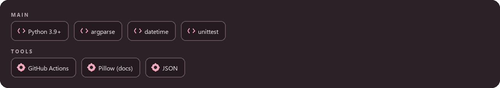
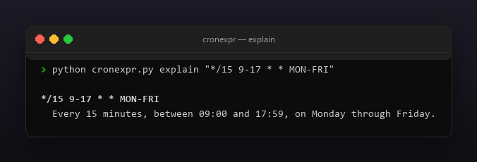
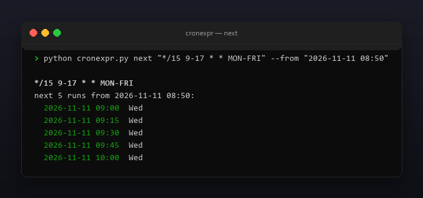

<p align="center"></p>

<p align="center">
  <a href="README.ru.md"></a>
  <a href="https://github.com/Celine1337/cronexpr/releases"></a>
  <a href="https://github.com/Celine1337/cronexpr/actions/workflows/ci.yml"></a>
  <a href="LICENSE"></a>
</p>


Cron expressions are terse and easy to get wrong: is `0 0 1 * MON` the 1st of
the month, every Monday, or both? cronexpr parses standard 5-field cron
(minute hour day-of-month month day-of-week) and answers in plain language:

- `explain` — a human-readable sentence for any expression;
- `next` — the next N run times, from now or a fixed `--from` moment;
- `validate` — exit `0` when valid, `1` with a precise reason when not.

Single file, standard library only, Python 3.9+, no network.


- Full 5-field syntax: `*`, lists `1,2`, ranges `1-5`, steps `*/15`, `1-30/5`
  and `5/15` (start-to-end-of-field); month names `JAN`–`DEC` and weekday names
  `SUN`–`SAT`, case-insensitive, including inside ranges (`MON-FRI`).
- `0` and `7` both mean Sunday; `5-7` expands to Fri, Sat, Sun.
- Standard (Vixie) cron day semantics: when day-of-month **and** day-of-week
  are both restricted, a day matching **either** fires the job (OR). `explain`
  prints a note whenever this applies.
- `next` computes run times with `datetime` field matching (month/day skips,
  not blind minute loops), strictly after `--from` (default: now, local time).
- `--json` for `explain`, `next` and `validate`; colored ANSI output with
  `--no-color` and `NO_COLOR`.
- Clear rejections: out-of-range values, reversed ranges, bad steps, empty
  list items, unknown names, Quartz extensions (`?`, `L`, `W`, `#`),
  `@nicknames` and 6/7-field (seconds/year) forms.


| Field | Range | Names |
|-------|-------|-------|
| minute | 0–59 | — |
| hour | 0–23 | — |
| day-of-month | 1–31 | — |
| month | 1–12 | `JAN`–`DEC` |
| day-of-week | 0–7 (0 and 7 = Sunday) | `SUN`–`SAT` |

Every field accepts `*`, comma lists, `a-b` ranges and `/step` suffixes.
`validate` reports the first problem with the field name and the offending
token, e.g. `minute: '61' out of range 0-59`.

Day-of-month / day-of-week interaction (standard cron):

| day-of-month | day-of-week | A day runs the job when |
|--------------|-------------|-------------------------|
| `*` | `*` | always |
| restricted | `*` | day-of-month matches |
| `*` | restricted | day-of-week matches |
| restricted | restricted | **either** matches (OR) |





```console
$ python cronexpr.py explain "*/15 9-17 * * MON-FRI"
$ python cronexpr.py next "0 9 * * MON" --count 3 --from "2026-11-11 08:50"
$ python cronexpr.py validate "61 * * * *"
$ python cronexpr.py explain "0 0 1 * MON" --json
```

```
*/15 9-17 * * MON-FRI
  Every 15 minutes, between 09:00 and 17:59, on Monday through Friday.
```

```
0 9 * * MON
next 3 runs from 2026-11-11 08:50:
  2026-11-16 09:00  Mon
  2026-11-23 09:00  Mon
  2026-11-30 09:00  Mon
```

```
invalid: 61 * * * *
  reason: minute: '61' out of range 0-59
```

Exit codes: `0` — success, `1` — invalid expression (or a schedule that never
fires within the 8-year search horizon), `2` — bad input (`--from`, `--count`,
argument errors).

Limits, on purpose: no Quartz extensions (`? L W #`), no `@daily`-style
nicknames, no seconds/year fields; times are naive local time (no timezone or
DST handling); `validate` checks syntax and ranges, it cannot prove a schedule
ever fires (`0 0 30 2 *` is syntactically valid but never runs — `next` says so).







```console
$ python -m unittest discover -s tests -v
```

42 tests cover parsing (lists, ranges, steps, names, Sunday 0/7), every
rejection class, explain wording, OR day semantics, next-run math (weekends,
month/year rollover, leap day, never-firing schedules) and CLI exit codes,
JSON and color gating. All images are regenerable offline:

```console
$ pip install pillow
$ python tools/make_shots.py      # docs/explain.png, docs/next.png
$ python tools/make_style.py tools/style.json docs/style
```


[MIT](LICENSE) © Celine1337