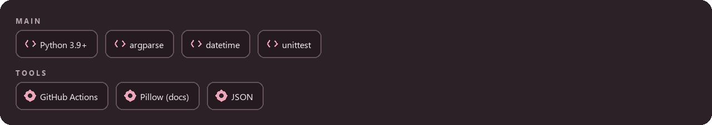
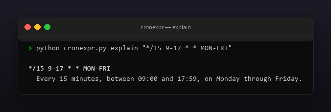
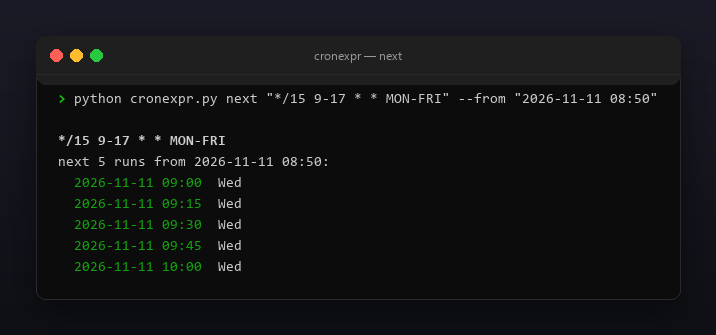

<p align="center"></p>

<p align="center">
  <a href="README.md"></a>
  <a href="https://github.com/Celine1337/cronexpr/releases"></a>
  <a href="https://github.com/Celine1337/cronexpr/actions/workflows/ci.yml"></a>
  <a href="LICENSE"></a>
</p>


Cron-выражения краткие и коварные: `0 0 1 * MON` — это 1-е число месяца,
каждый понедельник или и то и другое? cronexpr разбирает стандартный
5-полевой cron (минута час день-месяца месяц день-недели) и отвечает
понятным языком:

- `explain` — человекочитаемое предложение для любого выражения;
- `next` — следующие N запусков, от текущего момента или от фиксированного `--from`;
- `validate` — код `0`, если выражение валидно, и `1` с точной причиной, если нет.

Один файл, только стандартная библиотека, Python 3.9+, без сети.


- Полный синтаксис пяти полей: `*`, списки `1,2`, диапазоны `1-5`, шаги
  `*/15`, `1-30/5` и `5/15` (от значения до конца поля); имена месяцев
  `JAN`–`DEC` и дней недели `SUN`–`SAT` без учёта регистра, в том числе
  внутри диапазонов (`MON-FRI`).
- `0` и `7` — оба воскресенье; `5-7` разворачивается в пт, сб, вс.
- Стандартная (Vixie) семантика дней: если ограничены **и** день-месяца,
  **и** день-недели, задача запускается, когда совпадает **любой** из них
  (ИЛИ). `explain` печатает примечание, когда это применимо.
- `next` считает запуски сопоставлением полей через `datetime` (пропуски
  месяцев/дней, а не слепой перебор минут), строго после `--from`
  (по умолчанию: сейчас, локальное время).
- `--json` для `explain`, `next` и `validate`; цветной ANSI-вывод с
  `--no-color` и `NO_COLOR`.
- Понятные отказы: значения вне диапазона, перевёрнутые диапазоны, плохие
  шаги, пустые элементы списка, неизвестные имена, расширения Quartz
  (`?`, `L`, `W`, `#`), `@nickname` и формы из 6/7 полей (секунды/год).


| Поле | Диапазон | Имена |
|------|----------|-------|
| минута | 0–59 | — |
| час | 0–23 | — |
| день-месяца | 1–31 | — |
| месяц | 1–12 | `JAN`–`DEC` |
| день-недели | 0–7 (0 и 7 = воскресенье) | `SUN`–`SAT` |

Каждое поле принимает `*`, списки через запятую, диапазоны `a-b` и суффиксы
`/step`. `validate` сообщает первую проблему с именем поля и токеном,
например `minute: '61' out of range 0-59`.

Взаимодействие дня-месяца и дня-недели (стандартный cron):

| день-месяца | день-недели | День запускает задачу, когда |
|-------------|-------------|------------------------------|
| `*` | `*` | всегда |
| ограничен | `*` | совпадает день-месяца |
| `*` | ограничен | совпадает день-недели |
| ограничен | ограничен | совпадает **любой** (ИЛИ) |





```console
$ python cronexpr.py explain "*/15 9-17 * * MON-FRI"
$ python cronexpr.py next "0 9 * * MON" --count 3 --from "2026-11-11 08:50"
$ python cronexpr.py validate "61 * * * *"
$ python cronexpr.py explain "0 0 1 * MON" --json
```

```
*/15 9-17 * * MON-FRI
  Every 15 minutes, between 09:00 and 17:59, on Monday through Friday.
```

```
0 9 * * MON
next 3 runs from 2026-11-11 08:50:
  2026-11-16 09:00  Mon
  2026-11-23 09:00  Mon
  2026-11-30 09:00  Mon
```

```
invalid: 61 * * * *
  reason: minute: '61' out of range 0-59
```

Коды возврата: `0` — успех, `1` — невалидное выражение (или расписание,
которое ни разу не срабатывает в горизонте поиска 8 лет), `2` — неверный
ввод (`--from`, `--count`, ошибки аргументов).

Ограничения сознательные: без расширений Quartz (`? L W #`), без никнеймов
вида `@daily`, без полей секунд/года; время наивное локальное (без часовых
поясов и DST); `validate` проверяет синтаксис и диапазоны и не может
доказать, что расписание вообще сработает (`0 0 30 2 *` синтаксически
валидно, но никогда не запускается — `next` об этом скажет).







```console
$ python -m unittest discover -s tests -v
```

42 теста покрывают разбор (списки, диапазоны, шаги, имена, воскресенье 0/7),
все классы отказов, формулировки explain, ИЛИ-семантику дней, математику
запусков (выходные, переходы месяца/года, високосный день, несрабатывающие
расписания) и коды возврата CLI, JSON и управление цветом. Все картинки
перегенерируются офлайн:

```console
$ pip install pillow
$ python tools/make_shots.py      # docs/explain.png, docs/next.png
$ python tools/make_style.py tools/style.json docs/style
```


[MIT](LICENSE) © Celine1337